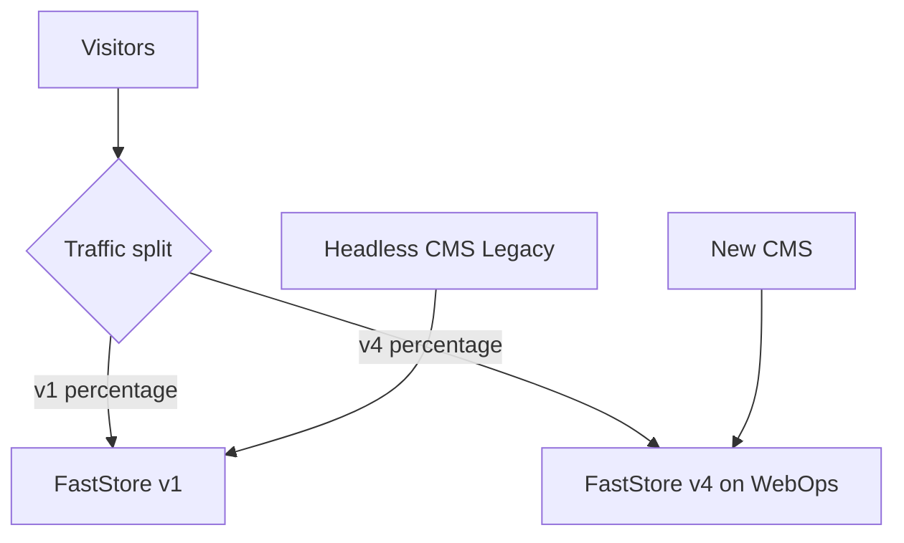

This guide explains how to gradually replace a FastStore v1 store with FastStore v4 in the same account, adopting the [CMS for FastStore storefronts](https://developers.vtex.com/docs/guides/cms-for-faststore-storefronts) on v4. v1 stays on Headless CMS (Legacy) until it's turned off. Traffic is split between both versions by percentage until v4 takes over completely.

> ℹ️ FastStore v3 and v4 run on WebOps and follow the same process. This guide also applies to migrations from v1 to v3.

## Before you begin

Use this guide if:

* Your current store runs on FastStore v1, with builds from a repository in the `vtex-sites` GitHub organization.
* You will use the new CMS on v4.
* You want a gradual migration with a quick rollback option.

If you need to keep using Headless CMS (Legacy) on v4, follow [Migrating from FastStore v1 to v4 keeping Headless CMS (Legacy)](https://developers.vtex.com/docs/guides/faststore/getting-started-faststore-v1-to-v4-with-hcms) instead.

For an overview of the process and how to confirm your project runs on FastStore v1, see [Migrating from FastStore v1 to v4](https://developers.vtex.com/docs/guides/faststore/getting-started-faststore-v1-to-v4).

> ⚠️ Traffic split is only available between FastStore v1 and v4 in the **same account and the same domain**. It isn't possible to split traffic between different accounts or subaccounts, or between two versions that already run on WebOps.

## How it works

1. Traffic split divides the visits between v1 and v4 according to the configured percentage. A cookie keeps each visitor on the same version for 24 hours. The parameters `?ab_test=v1` and `?ab_test=v2` force v1 and v4, respectively. Changes to the split percentage are requested through [VTEX Support](https://help.vtex.com/support). While the split is active, the store has no CDN cache, which impacts performance and cost, so plan its duration accordingly.
2. Each version has its own CMS. v1 stays on Headless CMS (Legacy) and v4 uses the new CMS. Publishing in one doesn't generate a build in the other. There is no internal configuration to switch and no synchronization between versions.
3. The WebOps onboarding creates the first v4 deploy. From then on, every commit to the main branch of the v4 repository creates a production deploy. For this reason, traffic split is activated before the onboarding, with 0% of the traffic on v4.

## Instructions

### Phase 1: Preparation

Complete these items in the weeks before the migration. This phase is the responsibility of you or your agency.

- [ ] The v4 repository exists in your GitHub organization, and its main branch builds without errors.
- [ ] The v4 content is ready in the new CMS, either created from scratch or migrated from Headless CMS (Legacy). Align the content migration with VTEX through a ticket.
- [ ] The `discovery.config` file of v4 has the correct domains for your account.
- [ ] The checkout is validated end to end on v4.

### Phase 2: Configuration

Complete these steps at least one day before the migration.

| # | Who | Action |
| --- | --- | --- |
| 1 | You | [Open a ticket with VTEX Support](https://help.vtex.com/support) at least one day in advance, requesting the activation of traffic split with 100% on v1 and 0% on v4. |
| 2 | VTEX | Activates traffic split and confirms in the ticket. |
| 3 | You | Complete the WebOps onboarding in the Admin, choosing the new CMS and connecting the v4 repository. Register your store domain in **WebOps Settings**. |
| 4 | You | Validate v4 in the production domain using `?ab_test=v2`, including the checkout. |

### Phase 3: Gradual rollout

| # | Who | Action |
| --- | --- | --- |
| 5 | You and VTEX | Increase the percentage of v4 in steps, for example 15%, 50%, and 100%, requesting each change through a ticket. Monitor errors and conversion. |
| 6 | You | With 100% of the traffic on v4, validate the store and the checkout once more and confirm the cutover in the ticket. |

### Phase 4: Post-migration

| # | Who | Action |
| --- | --- | --- |
| 7 | VTEX | Ends the traffic split and reactivates the CDN cache. |
| 8 | You | Remove the build URL from Headless CMS (Legacy) and archive the v1 repository or restrict commits to it. |

## Points of attention

* During the split, content lives in two CMSs. Changes that must apply to both versions need to be published in Headless CMS (Legacy) and in the new CMS while both receive traffic. Plan a content freeze or a routine of double publishing.
* During the split, the store has no CDN cache, which impacts performance and cost. Plan the duration of the split with this in mind.

## Rollback

| When | What to do |
| --- | --- |
| **During the split** | Open a ticket asking to return v4 to 0%. Traffic goes back to v1 without a new deploy. Headless CMS (Legacy) keeps publishing to v1 normally. |
| **After the split ends** | Contact VTEX through a ticket before taking any action. |
