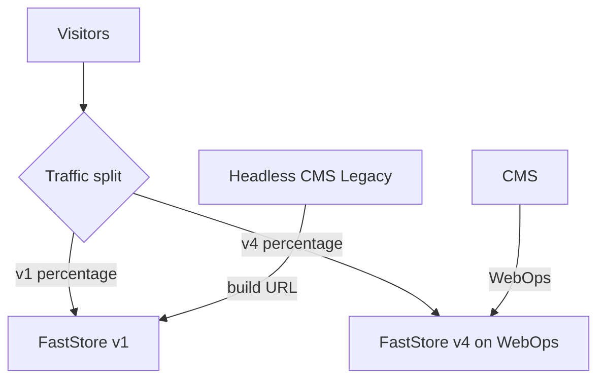

This guide explains how to gradually replace a FastStore v1 store with FastStore v4 in the same account, adopting the [CMS for FastStore storefronts](https://developers.vtex.com/docs/guides/cms-for-faststore-storefronts) on v4. Traffic is split between both versions by percentage until v4 takes over completely.

> ℹ️ FastStore v3 and v4 run on WebOps and follow the same process. This guide also applies to migrations from v1 to v3.

If you need to keep using [Headless CMS (Legacy)](https://developers.vtex.com/docs/guides/faststore/headless-cms-overview) on v4, follow [Migrating from FastStore v1 to v4 keeping Headless CMS (Legacy)](https://developers.vtex.com/docs/guides/faststore/getting-started-faststore-v1-to-v4-with-hcms) instead.

For an overview of the process and how to confirm your project runs on FastStore v1, see [Migrating from FastStore v1 to v4](https://developers.vtex.com/docs/guides/faststore/getting-started-faststore-v1-to-v4).

## Migration overview

The migration happens in four phases. The key idea is that v1 and v4 run side by side in the same account while traffic moves gradually from one to the other. Each version has its own content management system: v1 stays on Headless CMS (Legacy) and v4 uses the CMS.

1. **[Preparation](#phase-1-preparation):** create the v4 repository, prepare the content in the CMS, and review the domains and checkout on v4.
2. **[Configuration](#phase-2-configuration):** ask VTEX to activate traffic split with 0% on v4 and complete the WebOps onboarding.
3. **[Gradual rollout](#phase-3-gradual-rollout):** validate v4 and increase its share of the traffic until it reaches 100%.
4. **[Post-migration](#phase-4-post-migration):** VTEX ends the traffic split and you retire the v1 repository.

> ⚠️ Traffic split is only available between FastStore v1 and v4 in the **same account and the same domain**. It isn't possible to split traffic between different accounts or subaccounts, or between two versions that already run on WebOps.

The following diagram shows how traffic and content flow while both versions are live:

## Phase 1: Preparation

Complete these steps in the weeks before the migration. This phase is the responsibility of you or your agency.

The following table shows what happens in each version during this phase:

| **Step** | **FastStore v1 (current repository)** | **FastStore v4 (new repository, same account)** |
| --- | --- | --- |
| [1. Create the repository](#step-1---create-the-v4-repository) | No changes. The live store stays on v1 with no new development. | Create the v4 repository in your GitHub organization and make sure the main branch builds. |
| [2. Prepare the CMS content](#step-2---prepare-the-content-in-the-cms) | Headless CMS (Legacy) content remains as is. | Create the content in the CMS from scratch or migrate it from Headless CMS (Legacy). |
| [3. Domains](#step-3---configure-the-correct-domains-in-discoveryconfig) | No changes. | Review `discovery.config.js` so it has the correct account and domains. |
| [4. Checkout](#step-4---validate-the-checkout) | No changes. | Validate the checkout end to end on v4. |

### Step 1 - Create the v4 repository

Create the v4 repository in your GitHub organization and make sure its main branch builds without errors. From the WebOps onboarding on, every commit to the main branch creates a production deploy.

To create the v4 project, follow the guide [Starting a new FastStore project](https://developers.vtex.com/docs/guides/faststore/getting-started-2-starting-the-project).

### Step 2 - Prepare the content in the CMS

The v4 content must be ready in the new CMS, either created from scratch or migrated from Headless CMS (Legacy). Align the content migration with VTEX through a ticket.

> ℹ️ The two CMSs aren't synchronized. Publishing in one doesn't generate a build in the other.

### Step 3 - Configure the correct domains in `discovery.config`

The `discovery.config.js` file in the root of the v4 project defines the account and domains v4 uses. Wrong values can cause v4 to load the wrong data or break the checkout.

1. Open `discovery.config.js` and compare it with the configuration of your v1 store.
2. Confirm that the following properties match your account and production domain:

    | Property | What to check |
    | --- | --- |
    | `api.storeId` | Your VTEX account name. |
    | `api.workspace` | `master`, for production. |
    | `storeUrl` | Your primary store domain, for example, `https://www.mystore.com`. |
    | `secureSubdomain` | Your secure subdomain, if used, for example, `https://secure.mystore.com`. |
    | `checkoutUrl`, `loginUrl`, and `accountUrl` | The checkout, login, and account URLs on your domain. |

    For more details, see [Configuration options for discovery.config.js](https://developers.vtex.com/docs/guides/faststore/developer-tools-config-options).

### Step 4 - Validate the checkout

Validate the checkout end to end on v4 before the migration, including cart, shipping, and payment.

## Phase 2: Configuration

The following table shows what happens in each version during this phase:

| **Step** | **FastStore v1 (current repository)** | **FastStore v4 (new repository, same account)** |
| --- | --- | --- |
| 2.1 Traffic split ticket | No changes. | At least one day before the migration, open a ticket requesting traffic split. |
| 2.2 Traffic split | Receives 100% of the traffic. | VTEX activates traffic split with 0% on v4. |
| 2.3 WebOps onboarding | No changes. | Complete the WebOps onboarding in the Admin, choosing the new CMS and connecting the v4 repository. |
| 2.4 Validation | Still receives all the traffic. | Validate v4 using `?ab_test=v2`, including the checkout. |

Complete these steps at least one day before the migration.

| # | Who | Action |
| --- | --- | --- |
| 1 | You | [Open a ticket with VTEX Support](https://help.vtex.com/support) at least one day in advance, requesting the activation of traffic split with 100% on v1 and 0% on v4. |
| 2 | VTEX | Activates traffic split and confirms in the ticket. |
| 3 | You | Complete the WebOps onboarding in the Admin, choosing the new CMS and connecting the v4 repository. Register your store domain in **WebOps Settings**. |
| 4 | You | Validate v4 in the production domain using `?ab_test=v2`, including the checkout. |

Traffic split is activated before the onboarding because the onboarding creates the first v4 deploy, and the traffic must be on v1 when that happens.

## Phase 3: Gradual rollout

The following table shows what happens in each version during this phase:

| **Step** | **FastStore v1 (current repository)** | **FastStore v4 (new repository, same account)** |
| --- | --- | --- |
| 3.1 Increase traffic | Share of traffic decreases at each step. | Increase v4 in steps (for example, 15%, 50%, and 100%) through tickets, monitoring errors and conversion. |
| 3.2 Final validation | No longer receives traffic at 100%. | At 100%, validate the store and the checkout once more and confirm the cutover in the ticket. |

| # | Who | Action |
| --- | --- | --- |
| 5 | You and VTEX | Increase the percentage of v4 in steps, for example 15%, 50%, and 100%, requesting each change through a ticket. Monitor errors and conversion. |
| 6 | You | With 100% of the traffic on v4, validate the store and the checkout once more and confirm the cutover in the ticket. |

Traffic split works as follows:

* A cookie keeps each visitor on the same version for 24 hours.
* The parameters `?ab_test=v1` and `?ab_test=v2` force v1 and v4, respectively, which is useful to validate each version.
* Percentage changes are requested through [VTEX Support](https://help.vtex.com/support).

## Phase 4: Post-migration

The following table shows what happens in each version during this phase:

| **Step** | **FastStore v1 (current repository)** | **FastStore v4 (new repository, same account)** |
| --- | --- | --- |
| 4.1 End traffic split | No changes. | VTEX ends the traffic split and reactivates the CDN cache. v4 is the live store. |
| 4.2 Retire v1 | Remove the build URL from Headless CMS (Legacy) and archive the repository or restrict commits to it. | No changes. |

| # | Who | Action |
| --- | --- | --- |
| 7 | VTEX | Ends the traffic split and reactivates the CDN cache. |
| 8 | You | Remove the build URL from Headless CMS (Legacy) and archive the v1 repository or restrict commits to it. |

## Points of attention

* During the split, content lives in two CMSs. Changes that must apply to both versions need to be published in Headless CMS (Legacy) and in the new CMS while both receive traffic. Plan a content freeze or a routine of double publishing.
* During the split, the store has no CDN cache, which impacts performance and cost. Plan the duration of the split with this in mind.

## Rollback

| When | What to do |
| --- | --- |
| **During the split** | Open a ticket asking to return v4 to 0%. Traffic goes back to v1 without a new deploy. Headless CMS (Legacy) keeps publishing to v1 normally. |
| **After the split ends** | Contact VTEX through a ticket before taking any action. |
