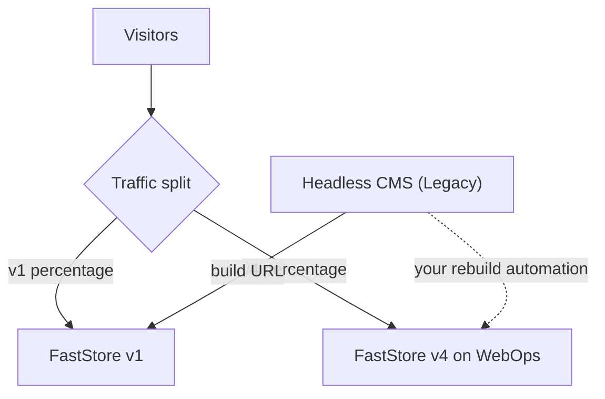

This guide explains how to gradually replace a FastStore v1 store with FastStore v4 in the same account, keeping the [Headless CMS (Legacy)](https://developers.vtex.com/docs/guides/faststore/headless-cms-overview) that already holds your production content. Traffic is split between both versions by percentage until v4 takes over completely.

> ℹ️ FastStore v3 and v4 run on WebOps and follow the same process. This guide also applies to migrations from v1 to v3.

If you want to use the [CMS for FastStore storefronts](https://developers.vtex.com/docs/guides/cms-for-faststore-storefronts) on v4, follow the [Migrating from FastStore v1 to v4 with CMS](https://developers.vtex.com/docs/guides/faststore/getting-started-faststore-v1-to-v4-with-cms) guide.

> ⚠️ Traffic split is only available between FastStore v1 and v4 in the **same account and the same domain**. You can't split traffic between different accounts or subaccounts, or between two versions that already run on WebOps.

For an overview of the process and how to confirm your project runs on FastStore v1, see [Migrating from FastStore v1 to v4](https://developers.vtex.com/docs/guides/faststore/getting-started-faststore-v1-to-v4).

## Migration overview

The migration happens in four phases. The key idea is that v1 and v4 run side by side in the same account while traffic moves gradually from one to the other.

1. **[Preparation](#phase-1-preparation):** create the v4 repository, make the Headless CMS (Legacy) content work on v4, and set up an automation that rebuilds v4 whenever content is published.
2. **[Configuration](#phase-2-configuration):** install the WebOps GitHub App and ask VTEX to activate traffic split with 0% on v4.
3. **[Gradual rollout](#phase-3-gradual-rollout):** validate v4 and increase its share of the traffic until it reaches 100%.
4. **[Post-migration](#phase-4-post-migration):** VTEX ends the traffic split and you retire the v1 repository.

The following diagram shows how traffic and content updates flow while both versions are live:



## Phase 1: Preparation

The following table shows what happens in each version during this phase:

| **Step** | **FastStore v1 (current repository)** | **FastStore v4 (new repository, same account)** |
| --- | --- | --- |
| [1. Create the repository](#step-1---create-the-v4-repository) | No changes. The live store stays on v1 with no new development. | Create the v4 repository in your GitHub organization and make sure the main branch builds. |
| [2. Sync Headless CMS (Legacy) content](#step-2---sync-the-headless-cms-legacy-content) | Headless CMS (Legacy) content remains as is. | Sync content types and sections, and confirm the content renders correctly on v4. |
| [3. Rebuild v4 on publish](#step-3---rebuild-v4-when-content-is-published) | The Headless CMS (Legacy) keeps building v1 through the current build URL. | Set up your own automation that triggers a v4 build whenever content is published. |
| [4. Domains](#step-4---configure-the-correct-domains-in-discoveryconfig) | No changes. | Review `discovery.config.js` so it has the correct account and domains. |

### Step 1 - Create the v4 repository

Create the v4 repository in your GitHub organization and make sure its main branch builds without errors. After WebOps is configured, every commit to the main branch creates a production deploy.

To create the v4 project, follow the guide [Starting a new FastStore project](https://developers.vtex.com/docs/guides/faststore/getting-started-2-starting-the-project).

### Step 2 - Sync the Headless CMS (Legacy) content

While traffic is split, both versions serve visitors using the same Headless CMS project, so the content must render correctly on both. Follow the steps below to make the Headless CMS (Legacy) content work on v1 and v4:

1. In the v4 project, sync the content types and sections with the Headless CMS (Legacy):

    ```bash
    yarn cms-sync
    ```

    > ⚠️ Run this command only after confirming the sections in v4 are compatible with the ones v1 uses, since the sync updates the schema of the project that v1 also reads.

2. Run `yarn dev` and open the main pages locally (home, category, product, and search) to confirm the content published in the Headless CMS (Legacy) renders as it does in v1.
3. Fix any differences, such as sections or props that no longer exist in v4, before moving on.

### Step 3 - Rebuild v4 when content is published

During the split, the Headless CMS (Legacy) keeps building only v1 through the current build URL. For more details, see [Integrating your storefront with Headless CMS (legacy)](https://developers.vtex.com/docs/guides/faststore/integration-overview).

The v4 project doesn't receive content updates automatically, so you need to trigger a new v4 build every time content is published. Follow these steps to set up an automation that rebuilds v4 whenever content is published:

1. Choose how to detect a publication. For example, receive a notification from your own service or run a scheduled job that checks for new content.
2. When a publication is detected, trigger a new build of the v4 project. For example, push an empty commit to the main branch, which creates a new WebOps deploy:

    ```bash
    git commit --allow-empty -m "chore: rebuild v4 with updated CMS content"
    git push origin main
    ```

3. Automate this step in your CI or in a script, and test it by publishing a change in the Headless CMS (Legacy) and confirming it appears in v4.

> ℹ️ You deactivate this automation in [Phase 3](#phase-3-gradual-rollout), after the build URL points to v4.

### Step 4 - Configure the correct domains in `discovery.config`

The `discovery.config.js` file in the root of the v4 project defines the account and domains v4 uses. Wrong values can cause v4 to load the wrong data or break the checkout.

1. Open `discovery.config.js` and compare it with the configuration of your v1 store.
2. Confirm that the following properties match your account and production domain:

    | Property | What to check |
    | --- | --- |
    | `api.storeId` | Your VTEX account name. |
    | `api.workspace` | `master`, for production. |
    | `storeUrl` | Your primary store domain, for example, `https://www.mystore.com`. |
    | `secureSubdomain` | Your secure subdomain, if used, for example, `https://secure.mystore.com`. |
    | `checkoutUrl`, `loginUrl`, and `accountUrl` | The checkout, login, and account URLs on your domain. |

    For more details, see [Configuration options for discovery.config.js](https://developers.vtex.com/docs/guides/faststore/developer-tools-config-options).

3. Commit the changes to a branch other than main, and merge them only when the WebOps configuration is confirmed in [Phase 2](#phase-2-configuration).

## Phase 2: Configuration

The following table shows what happens in each version during this phase:

| **Step** | **FastStore v1 (current repository)** | **FastStore v4 (new repository, same account)** |
| --- | --- | --- |
| 2.1 WebOps app and ticket | No changes. | At least one day before the migration, install the WebOps GitHub App and open a ticket requesting traffic split. |
| 2.2 Traffic split | Receives 100% of the traffic. | VTEX activates traffic split with 0% on v4. |
| 2.3 WebOps setup | No changes. | VTEX configures WebOps with your existing Headless CMS project. Don't commit to main until VTEX confirms. |

Complete these steps at least one day before the migration:

| # | Who | Action |
| --- | --- | --- |
| 1 | You | Install the [FastStore WebOps GitHub App](https://github.com/apps/faststore-webops) in your organization, with access to the v4 repository. |
| 2 | You | [Open a ticket with VTEX Support](https://help.vtex.com/support) at least one day in advance, with your `ACCOUNT`, `ORG`, `REPO`, `REPO_ID`, and `INSTALLATION_ID`, requesting the activation of traffic split. |
| 3 | VTEX | Activates traffic split with 100% on v1 and 0% on v4. |
| 4 | VTEX | Configures WebOps pointing to your existing Headless CMS project and adds the primary domain. VTEX confirms in the ticket. |
| 5 | You | Don't commit to the main branch of the v4 repository until VTEX confirms step 4 in the ticket. |

VTEX configures WebOps because the WebOps onboarding in the Admin only offers the new CMS and has no option for Headless CMS (Legacy). When you install the GitHub App, you see the following error. This error is expected and indicates that VTEX still needs to finish the configuration:

```json
{
  "status": "pending",
  "message": "Could not find installation intent. If you started this installation outside Faststore WebOps, follow the Faststore Cloud migration guide to finish linking your project."
}
```

## Phase 3: Gradual rollout

The following table shows what happens in each version during this phase:

| **Step** | **FastStore v1 (current repository)** | **FastStore v4 (new repository, same account)** |
| --- | --- | --- |
| 3.1 First deploy and validation | Still receives all the traffic. | Commit to main, wait for the deploy, and validate v4 using `?ab_test=v2`, including the checkout. |
| 3.2 Increase traffic | Share of traffic decreases at each step. | Increase v4 in steps (for example, 15%, 50%, and 100%) through tickets, monitoring errors and conversion. |
| 3.3 Switch the build URL | No longer receives traffic or content updates. | At 100%, point the Headless CMS build URL to v4 and deactivate your rebuild automation. |
| 3.4 Switch the CMS configuration | Stops being built by the Headless CMS. | VTEX switches the internal configuration so the Headless CMS builds v4. Publish a test to confirm. |

| # | Who | Action |
| --- | --- | --- |
| 6 | You | Commit to the main branch of the v4 repository and wait for the deploy. |
| 7 | You | Validate v4 in the production domain using `?ab_test=v2`, including the checkout. |
| 8 | You and VTEX | Increase the percentage of v4 in steps, for example 15%, 50%, and 100%, requesting each change through a ticket. Monitor errors and conversion. |
| 9 | You | With 100% of the traffic on v4, change the Headless CMS build URL to v4 and deactivate your rebuild automation. |
| 10 | You | Open a ticket asking VTEX to switch the internal Headless CMS configuration, so it builds v4 by default instead of v1. |
| 11 | VTEX | Switches the configuration and confirms in the ticket. |
| 12 | You | Publish a test in the Headless CMS and confirm it generated a v4 build in WebOps. |

Traffic split works as follows:

* A cookie keeps each visitor on the same version for 24 hours.
* The parameters `?ab_test=v1` and `?ab_test=v2` force v1 and v4, respectively, which is useful to validate each version.
* Percentage changes are requested through [VTEX Support](https://help.vtex.com/support).

> ⚠️ Only ask VTEX to switch the Headless CMS configuration when 100% of the traffic is on v4, the store is validated, and the build URL already points to v4. If the configuration is switched earlier, publications stop being reflected on v1, which still receives traffic.

## Phase 4: Post-migration

The following table shows what happens in each version during this phase:

| **Step** | **FastStore v1 (current repository)** | **FastStore v4 (new repository, same account)** |
| --- | --- | --- |
| 4.1 End traffic split | No changes. | VTEX ends the traffic split and reactivates the CDN cache. v4 is the live store. |
| 4.2 Retire v1 | Archive the repository or restrict commits to it. | No changes. |

| # | Who | Action |
| --- | --- | --- |
| 13 | VTEX | Ends the traffic split and reactivates the CDN cache. |
| 14 | You | Archive the v1 repository or restrict commits to it. |

## Points of attention

* During the split, the store has no CDN cache, which impacts performance and cost. Plan the duration of the split with this in mind.
* Headless CMS (Legacy) stores are being gradually upgraded to the new VTEX CMS. See the announcement [Headless CMS (Legacy): Stores will be upgraded to the new VTEX CMS](https://help.vtex.com/announcements/2026-03-30-headless-cms-stores-will-be-upgraded-to-the-new-vtex-cms).

## Rollback

| When | What to do |
| --- | --- |
| **During the split** | Open a ticket asking to return v4 to 0%. Traffic goes back to v1 without a new deploy. |
| **After the Headless CMS configuration switch** | Return v4 to 0% and ask VTEX to revert the configuration, so publications are reflected on v1 again. |
| **After the split ends** | Contact VTEX through a ticket before taking any action. |
