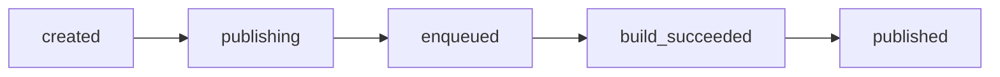

The [Release Status Log API](https://developers.vtex.com/docs/api-reference/release-status-log-api) returns the history of your account's releases, step by step. Each entry in the log is one step event of a release, such as `created`, `publishing`, `published`, or `failed`. You choose a time window and get every event that happened in it.

This guide explains how to query the log, follow a single release, read more than 1000 entries, and monitor releases continuously. For the complete list of parameters, response fields, `step` values, and status codes, see the [Get release history](https://developers.vtex.com/docs/api-reference/release-status-log-api#get-/releases/history) endpoint reference.

## Before you begin

The user or [API key](https://developers.vtex.com/docs/guides/api-authentication-using-api-keys) used in the request must have the **Visualize Releases** [License Manager resource](https://help.vtex.com/en/tutorial/license-manager-resources--3q6ztrC8YynQf6rdc6euk3).

The token must also have been issued for the same account informed in the `an` query parameter. A token issued for another account is refused with a `403` status code, even if its user has a role in that account. For an API key, the account is the one the key belongs to.

To learn more, see [Authentication overview](https://developers.vtex.com/docs/guides/authentication).

## Query the release history

Send a `GET` request to `https://releases.vtex.io/releases/history` with the account name and the time window. The following example gets everything that happened in a 24-hour period:

```sh
curl --request GET \
  --header "Accept: application/json" \
  --header "VtexIdclientAutCookie: $TOKEN" \
  "https://releases.vtex.io/releases/history?an=myaccount&startDate=2026-10-19T12:00:00Z&endDate=2026-10-20T12:00:00Z"
```

The time window is `[startDate, endDate)`: `startDate` is inclusive, and `endDate` is exclusive. Both must be [RFC 3339](https://datatracker.ietf.org/doc/html/rfc3339) date-times. The response returns entries sorted by `occurredAt` in ascending order:

```json
{
  "history": [
    {
      "id": "6650f1a2c3d4e5f607182930",
      "releaseId": "a1b2c3d4",
      "accountName": "myaccount",
      "step": "created",
      "occurredAt": "2026-10-19T14:02:11.000Z",
      "actor": {
        "type": "user",
        "id": "7c1e0f52-0000-0000-0000-000000000000"
      }
    },
    {
      "id": "6650f1a2c3d4e5f607182931",
      "releaseId": "a1b2c3d4",
      "accountName": "myaccount",
      "step": "published",
      "occurredAt": "2026-10-19T14:05:47.000Z",
      "outcome": "success"
    }
  ],
  "truncated": false,
  "lastOccurredAt": "2026-10-19T14:05:47.000Z"
}
```

Optional fields, such as `outcome`, `reason`, `error`, `actor`, and `related`, are omitted when they have no value.

### Limits

| **Limit** | **Value** |
| --------------- | ----------------- |
| Maximum range between `startDate` and `endDate` | 15 days. |
| Oldest allowed `startDate` | 365 days back (history retention window). |
| Maximum entries per response | 1000. |
| Rate limit | 60 requests per minute per account. |
| Query timeout | 5 seconds. |

To cover a period longer than 15 days, split it into several windows of up to 15 days each and send one request per window.

## Follow a single release

All events of a release share the same `releaseId`. Group the entries by this field to read the release's sequence. For example:



This is an example of a successful sequence. A step can happen more than once for the same release, and the steps that appear depend on what happened to it.

The log doesn't include release names. To find the name of a release, use the List Releases endpoint. The `id` it returns is the `releaseId` used in the log.

## Read more than 1000 entries

A response holds at most 1000 entries. When `truncated` is `true`, more entries exist in your time window. To read them:

1. Send the request again with `startDate` set to the `lastOccurredAt` value of the previous response, and the **same** `endDate`.
2. Repeat step 1 until `truncated` is `false`.
3. De-duplicate the entries by `id`. Several entries can share the same timestamp at the boundary between two responses, so the same entry may be returned twice.

## Monitor releases continuously

To monitor release status from your own application, poll the endpoint at regular intervals:

1. Store the `lastOccurredAt` value of the last entry you processed.
2. In the next request, use that value as `startDate`, and use the current date and time as `endDate`.
3. De-duplicate entries by `id` before processing them.

This avoids reading old entries again and keeps your integration within the rate limit.

>ℹ️ A date in the future is accepted as `endDate`.

## Handle errors

| **Status code** | **What to do** |
| --------------- | ----------------- |
| `400` | Check the request. This status is returned for missing or invalid dates, a `startDate` that isn't before `endDate`, a range over 15 days, a `startDate` older than the retention window, an unknown account, or a missing authorization token. |
| `401` | The token is invalid. Generate a new token. |
| `403` | Check if the user or API key has the **Visualize Releases** resource, and if the token was issued for the account informed in `an`. |
| `429` | Wait the number of seconds informed in the `Retry-After` response header, then retry. Don't retry immediately. Requests refused with `403` don't count toward the rate limit. |
| `503` | The query took too long. Retry with a narrower time window. |

>⚠️ Narrower time windows return faster. If you receive a `503` status code, shorten the window between `startDate` and `endDate`.
