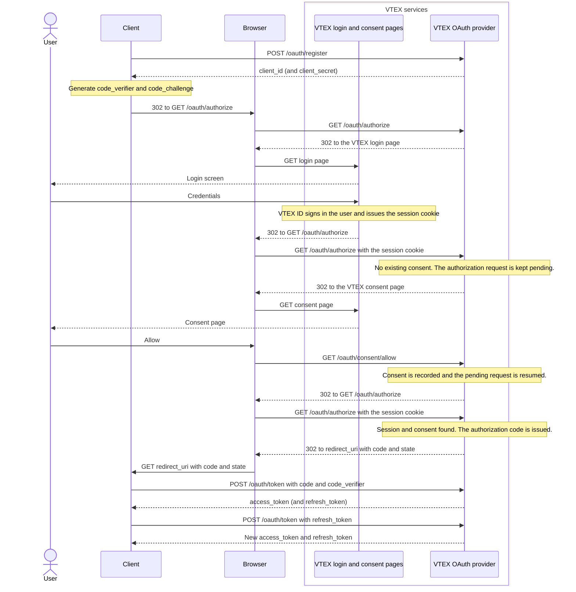

The VTEX OAuth provider lets external clients, such as AI agents, MCP clients, and partner apps, ask a VTEX user for permission and act on their behalf. It follows the [OAuth 2.1](https://oauth.net/2.1/) authorization code flow with [PKCE](https://oauth.net/2/pkce/), so you can use the OAuth libraries you already know instead of building a custom integration.

OAuth is an open standard that lets an app access a user's data on another service without receiving the user's password. In this guide, the **client** is the app that wants to access a VTEX user's data, and the VTEX OAuth provider verifies the user, asks for their permission, and issues the tokens.

>ℹ️ This guide is for apps that access VTEX on behalf of a user. If you want to let store customers log in with an external identity provider, see [Webstore login with an external OAuth 2.0 provider](https://developers.vtex.com/docs/guides/login-integration-guide-webstore-oauth2).

With the VTEX OAuth provider, clients can:

- Register themselves, with no manual setup per client.
- Request access from a VTEX user and keep that access without asking the user to sign in again, using refresh tokens.
- Discover how the provider works through standard discovery documents and verify tokens on their own.

All endpoints belong to the [VTEX ID API](https://developers.vtex.com/docs/api-reference/vtex-id-api), under the **OAuth provider** tag.

## Before you start

The VTEX OAuth provider issues VTEX ID access tokens on behalf of a user. It doesn't replace [application keys](https://developers.vtex.com/docs/guides/api-authentication-using-api-keys) for server-to-server integrations. To choose the credential that fits your use case, see the [Authentication](https://developers.vtex.com/docs/guides/authentication) guide.

## Discovery

Clients can find the provider's endpoints automatically instead of hardcoding them:

| Document | Endpoint | Specification |
| ----- | ----- | ----- |
| Authorization server metadata | [`GET /.well-known/oauth-authorization-server/{tenant}`](https://developers.vtex.com/docs/api-reference/vtex-id-api#get-/.well-known/oauth-authorization-server/-tenant-) | [RFC 8414](https://datatracker.ietf.org/doc/html/rfc8414) |
| OpenID Connect discovery | [`GET /.well-known/openid-configuration`](https://developers.vtex.com/docs/api-reference/vtex-id-api#get-/.well-known/openid-configuration) | OpenID Connect Discovery |
| Public keys to verify tokens | [`GET /.well-known/jwks.json`](https://developers.vtex.com/docs/api-reference/vtex-id-api#get-/.well-known/jwks.json) | [RFC 7517](https://datatracker.ietf.org/doc/html/rfc7517) |

In the `{tenant}` path parameter, use the account name.

## Authorization flow

The following diagram shows the authorization code flow, from client registration to refreshing the access token. Redirects (`302`) are shown as separate steps, because the user's browser carries the flow between your client and VTEX:



If the user selects to deny access, the browser calls `GET /oauth/consent/deny` instead, and VTEX redirects to the `redirect_uri` with the `access_denied` error.

### What the user sees

During the flow, the user leaves your client, interacts with VTEX pages, and returns to your client:

1. **Login:** if the user doesn't have an active VTEX session, VTEX shows the VTEX Admin login screen, where the user enters their email and selects **Continue**, or signs in with Google. The user signs in on VTEX and never enters their password in your client.
2. **Consent:** VTEX shows a consent screen titled **Authorize Access**, which says that an application is requesting access and lists what it needs to do: identify the user by reading their profile and email, know which resources the user can access by reading their roles and assigned resources, and act on the user's behalf using those resources. The screen doesn't show your client's name. If the user has the Super Admin role, the screen also warns that the application will act across all resources and requires the user to confirm before allowing access. The user then selects **Allow** or **Cancel**. These screens are provided by VTEX and are the same for every client, so you can't customize them. If the user already allowed your client, they don't need to consent again.

   

   For users with the Super Admin role, the screen includes a warning and a checkbox that the user must select to enable the **Allow** button.

   

3. **Return to your client:** VTEX redirects the user to your `redirect_uri`. If the user allowed access, the URL includes the `code` and the `state`. If the user denied access, it includes `error=access_denied` and the `state`.

Your client must handle both outcomes. For example, when the user denies access, show a message explaining that the client can't continue without permission, and offer to try again.

The following steps describe the flow from the client's perspective:

1. [Register the client](#step-1-register-the-client).
2. [Send the user to the authorization endpoint](#step-2-request-authorization).
3. The user signs in, if needed, and grants or denies access to the client.
4. [Exchange the authorization code for an access token](#step-3-exchange-the-code-for-an-access-token).
5. [Use the access token](#step-4-use-and-validate-the-access-token) and, when it expires, [refresh it](#refreshing-the-access-token).

### Step 1 - Register the client

Each client registers once, using the [Register client](https://developers.vtex.com/docs/api-reference/vtex-id-api#post-/api/vtexid/v1/oauth/register) endpoint, which implements [dynamic client registration (RFC 7591)](https://datatracker.ietf.org/doc/html/rfc7591).

```bash
curl --request POST \
  --url 'https://{accountName}.myvtex.com/api/vtexid/v1/oauth/register' \
  --header 'Content-Type: application/json' \
  --data '{
    "client_name": "My App",
    "redirect_uris": ["https://app.example.com/callback"],
    "token_endpoint_auth_method": "client_secret_basic",
    "grant_types": ["authorization_code", "refresh_token"],
    "response_types": ["code"]
  }'
```

| Field | Description |
| ----- | ----- |
| `redirect_uris` | Required. Absolute URIs where VTEX redirects the user after the authorization. |
| `client_name` | Human-readable name of the client. |
| `token_endpoint_auth_method` | How the client authenticates at the token endpoint: `client_secret_basic` (default), `client_secret_post`, or `none` for public clients. |
| `grant_types` | Must include `authorization_code`. Add `refresh_token` to let the client refresh access tokens. |
| `response_types` | Must include `code`. |

The response contains the `client_id` and, for confidential clients, the `client_secret`. Store the secret securely: never expose it in frontend code or public repositories.

### Step 2 - Request authorization

Generate a PKCE `code_verifier` and derive the `code_challenge` from it with the `S256` method. Then redirect the user's browser to the [Request authorization code](https://developers.vtex.com/docs/api-reference/vtex-id-api#get-/api/vtexid/v1/oauth/authorize) endpoint:

```text
https://{accountName}.myvtex.com/api/vtexid/v1/oauth/authorize
  ?response_type=code
  &client_id={client_id}
  &redirect_uri=https://app.example.com/callback
  &scope=openid
  &state={state}
  &code_challenge={code_challenge}
  &code_challenge_method=S256
```

If the user isn't signed in, VTEX asks them to log in. Then VTEX shows a consent page, where the user grants or denies access to your client. The consent page calls the [Allow consent](https://developers.vtex.com/docs/api-reference/vtex-id-api#get-/api/vtexid/v1/oauth/consent/allow) or [Deny consent](https://developers.vtex.com/docs/api-reference/vtex-id-api#get-/api/vtexid/v1/oauth/consent/deny) endpoint, so your client doesn't need to call them.

After the user grants access, VTEX redirects the user agent to your `redirect_uri` with the `code` and the `state` you sent. Check that the `state` matches the one you generated. If the authorization fails, VTEX redirects with the `error` and `state` in the URL fragment.

### Step 3 - Exchange the code for an access token

Call the [Get access token](https://developers.vtex.com/docs/api-reference/vtex-id-api#post-/api/vtexid/v1/oauth/token) endpoint with the `code` and the `code_verifier` you generated in the previous step. Confidential clients authenticate with their `client_id` and `client_secret`, either in the body or through HTTP Basic authentication.

```bash
curl --request POST \
  --url 'https://{accountName}.myvtex.com/api/vtexid/v1/oauth/token' \
  --header 'Content-Type: application/x-www-form-urlencoded' \
  --data-urlencode 'grant_type=authorization_code' \
  --data-urlencode 'code={code}' \
  --data-urlencode 'redirect_uri=https://app.example.com/callback' \
  --data-urlencode 'code_verifier={code_verifier}' \
  --data-urlencode 'client_id={client_id}' \
  --data-urlencode 'client_secret={client_secret}'
```

The response contains the access token:

```json
{
  "access_token": "eyJhbGciOiJSUzI1NiIsInR5cCI6IkpXVCJ9...",
  "token_type": "Bearer",
  "expires_in": 86400,
  "refresh_token": "opaque-refresh-token-handle"
}
```

The `refresh_token` is only returned if the client registered for the `refresh_token` grant.

### Step 4 - Use and validate the access token

The access token is a VTEX ID token. Resource servers and clients can verify it in two ways:

- **Locally**, checking the signature with the public keys from the [JWKS endpoint](https://developers.vtex.com/docs/api-reference/vtex-id-api#get-/.well-known/jwks.json).
- **Through introspection**, with the [Introspect access token](https://developers.vtex.com/docs/api-reference/vtex-id-api#post-/api/vtexid/v1/oauth/introspect) endpoint, which returns `{"active": true}` along with the token claims, or `{"active": false}` if the token isn't valid. Public clients (`token_endpoint_auth_method` set to `none`) can't use this endpoint.

## Refreshing the access token

To keep access without asking the user to sign in again, call the [Get access token](https://developers.vtex.com/docs/api-reference/vtex-id-api#post-/api/vtexid/v1/oauth/token) endpoint with `grant_type=refresh_token`:

```bash
curl --request POST \
  --url 'https://{accountName}.myvtex.com/api/vtexid/v1/oauth/token' \
  --header 'Content-Type: application/x-www-form-urlencoded' \
  --data-urlencode 'grant_type=refresh_token' \
  --data-urlencode 'refresh_token={refresh_token}' \
  --data-urlencode 'client_id={client_id}' \
  --data-urlencode 'client_secret={client_secret}'
```

Each refresh token can be used only once. Every successful refresh returns a new `refresh_token`, and the one you just used stops working. Presenting a refresh token a second time fails with `invalid_grant`, so always store the latest one.

>ℹ️ The OAuth `refresh_token` is not the same as the `vid_rt` refresh token used in [headless storefronts](https://developers.vtex.com/docs/guides/refresh-token-flow-for-headless-implementations). When you request an access token, VTEX creates a session for your client that is independent from the user's browser session. VTEX keeps the underlying VTEX ID refresh token on its servers and gives your client only an opaque `refresh_token` to use at the token endpoint. Because the sessions are independent, the user signing out of their browser doesn't end your client's session. To end it, [revoke the token](#revoking-tokens).

## Revoking tokens

To end a session, call the [Revoke token](https://developers.vtex.com/docs/api-reference/vtex-id-api#post-/api/vtexid/v1/oauth/revoke) endpoint with either the access token or the refresh token. Revoking either one ends the whole client session, so all its refresh tokens stop working. Public clients can revoke their own tokens without a secret.

## Common errors

Token, introspection, revocation, and registration endpoints return errors in the format defined by [RFC 6749](https://datatracker.ietf.org/doc/html/rfc6749#section-5.2):

```json
{
  "error": "invalid_grant",
  "error_description": "The provided authorization grant is invalid, expired, or revoked."
}
```

| Error | Meaning |
| ----- | ----- |
| `invalid_request` | A required parameter is missing or the request is malformed. |
| `invalid_client` | The client doesn't exist, isn't active, or failed authentication. |
| `invalid_grant` | The authorization code or refresh token is unknown, expired, already used, or was issued to a different client. |
| `unauthorized_client` | The client isn't registered for the requested grant, for example, using `refresh_token` without registering for it. |
| `unsupported_grant_type` | The `grant_type` isn't supported. |
| `invalid_redirect_uri` | The `redirect_uri` isn't a valid absolute URI or isn't registered for the client. |
| `invalid_client_metadata` | The registration metadata is invalid. |
