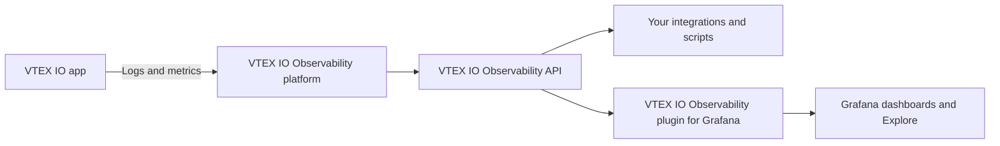

> ⚠️ VTEX IO Observability is currently in beta, which means that VTEX is working to improve it. If you have any questions, contact [VTEX Support](https://supporticket.vtex.com/support).

**VTEX IO Observability** gives you access to logs and metrics from your [VTEX IO apps](https://developers.vtex.com/docs/guides/vtex-io-documentation-what-is-a-vtex-app), so you can monitor app health, investigate errors, and analyze performance in production. You can query this data programmatically with the [**VTEX IO Observability API**](https://developers.vtex.com/docs/guides/vtex-io-observability-api-guide) or visualize it in [Grafana](https://grafana.com/) dashboards with the [**VTEX IO Observability plugin for Grafana**](https://developers.vtex.com/docs/guides/vtex-io-observability-plugin).

This guide introduces VTEX IO Observability, the data it provides, and the tools you can use to access it. Each section explains a capability and links to the detailed guide or API reference.

## Architecture overview

VTEX IO Observability collects logs and metrics from your apps in production and makes them available through an API. The Grafana plugin is a client of this API, so both tools access the same data.

The solution is built around the following components:

- **VTEX IO apps:** Your apps generate logs with the standard [`logger`](https://developers.vtex.com/docs/guides/vtex-io-documentation-managing-application-logs) from the `@vtex/api` package. The VTEX IO runtime also records HTTP request metrics for each app, such as request count and latency.
- **VTEX IO Observability platform:** The platform stores logs and metrics per VTEX account, the data's tenant. Data from one account is isolated from other accounts.
- **VTEX IO Observability API:** The API exposes endpoints to query logs and metrics with filters, aggregations, ordering, and pagination, and to discover apps, fields, and metric names. Responses use the [Grafana data frame format](https://grafana.com/docs/grafana/latest/developers/plugins/data-frames/).
- **VTEX IO Observability plugin for Grafana:** A [Grafana data source](https://grafana.com/docs/grafana/latest/datasources/) retrieves data from the API and displays it in dashboards and in **Explore**. The plugin doesn't store logs or metrics in Grafana.

## Authentication

Both the API and the Grafana plugin authenticate with a VTEX [API key and token](https://help.vtex.com/en/docs/tutorials/generated-keys) pair. The API key must be associated with a [role](https://help.vtex.com/en/docs/tutorials/roles) that includes the `colossus-read-logs` [License Manager resource](https://help.vtex.com/docs/tutorials/license-manager-resources).

The [account name](https://help.vtex.com/docs/tutorials/what-is-an-account-name) in the API key, which follows the format `vtexappkey-{accountName}-{suffix}`, must match the account you query. Cross-account access is blocked, so you can only access data from the account that generated the key.

>ℹ️ For the authentication headers and permission errors, see [Before you begin](https://developers.vtex.com/docs/guides/vtex-io-observability-api-guide#before-you-begin) and [Error codes](https://developers.vtex.com/docs/guides/vtex-io-observability-api-guide#error-codes) in the API guide.

## App requirements

Logs and metrics are available only for apps that meet all of the following requirements:

- The app vendor is your account name. Apps installed in your account but developed by other vendors aren't included. You can observe apps from other accounts where you are the vendor.
- The app uses version `7.x` of the [`node` builder](https://developers.vtex.com/docs/guides/vtex-io-documentation-node-builder). You can check the builder version in the `builders` field of the app's [`manifest.json`](https://developers.vtex.com/docs/guides/vtex-io-documentation-manifest) file.
- The app generates logs with the standard `logger` from the `@vtex/api` package, available in the `ctx.vtex` object. For more information, see [Managing application logs](https://developers.vtex.com/docs/guides/vtex-io-documentation-managing-application-logs#implementing-the-vtex-io-logging-service).
- The app is [deployed](https://developers.vtex.com/docs/guides/vtex-io-documentation-deploying-the-app-stable-version) and installed in a production [workspace](https://developers.vtex.com/docs/guides/vtex-io-documentation-workspace).

## Available data

VTEX IO Observability provides two types of data: logs and metrics. Each type has its own set of columns that you can select and filter in queries.

### Logs

Logs are the entries your app writes with the `logger`, enriched with context about where and when they were generated. You can filter and correlate log entries with the following options:

- **Log level**: Filter entries by `debug`, `info`, `warn`, or `error` level.
- **Execution context**: Identify the `app`, `account`, and `workspace` of each entry, and whether it comes from a production workspace.
- **Request tracing**: Correlate entries using the `requestId`, `operationId`, and `TraceId` fields.
- **Message search**: Search the log message body, stored in the `data` field, by substring pattern.

For the full list of log columns, see [Logs columns](https://developers.vtex.com/docs/guides/vtex-io-observability-api-guide#logs-columns).

### Metrics

Metrics are time series that describe your app's behavior, such as request rate, error rate, and latency. They're pre-aggregated to one-minute intervals and support the `gauge`, `sum`, and `histogram` metric types. You can use the following features to work with metrics:

- **HTTP request metrics**: Analyze request count with the `runtime_http_requests_total` metric and latency with the `runtime_http_requests_duration_milliseconds` histogram.
- **Aggregations**: Calculate `sum`, `avg`, `count`, `min`, and `max` values, grouped by columns of your choice.
- **Custom attributes**: Filter and group metrics by attributes stored in the `Attributes` map, such as `Attributes['status_code']`.
- **Metric discovery**: List the metric names an app sent within a time range.

For the full list of metric columns, see [Metrics columns](https://developers.vtex.com/docs/guides/vtex-io-observability-api-guide#metrics-columns).

## Choosing how to access your data

The API and the Grafana plugin access the same data. Choose the tool according to your use case as in the following table:

| Use case | Recommended tool |
| :---- | :---- |
| Monitor app health in dashboards that you can save and share | Grafana plugin |
| Investigate logs and metrics interactively without writing queries | Grafana plugin |
| Build custom queries with filters, aggregations, and custom attributes | API |
| Integrate app data with your own tools, scripts, or monitoring systems | API |

## VTEX IO Observability API

The **VTEX IO Observability API** provides programmatic access to logs and metrics. The query endpoints are the main ones for retrieving data, and the other endpoints help you discover the apps, fields, metric names, and operators you can use to build queries. The API supports the following operations:

- **Query logs and metrics**: Retrieve data with filters, aggregations (metrics only), ordering, and pagination.
- **Discover apps**: List the apps that sent logs or metrics within a time range.
- **Discover fields and metric names**: List the queryable columns for logs and metrics, and the metric names an app sent.
- **Discover capabilities**: Retrieve the supported operators, aggregation functions, and query limits.

The API provides the following endpoints:

- `POST` [Query logs](https://developers.vtex.com/docs/api-reference/observability-api#post-/api/extensions/observability/logs/-tenant-/query): Filters and paginates logs data.
- `GET` [Get logs fields](https://developers.vtex.com/docs/api-reference/observability-api#get-/api/extensions/observability/logs/-tenant-/fields): Returns the available columns for logs queries.
- `POST` [Query metrics](https://developers.vtex.com/docs/api-reference/observability-api#post-/api/extensions/observability/metrics/-tenant-/query): Filters, aggregates, and paginates metrics data.
- `GET` [Get metrics fields](https://developers.vtex.com/docs/api-reference/observability-api#get-/api/extensions/observability/metrics/-tenant-/fields): Returns the available columns for metrics queries.
- `GET` [Get metric names](https://developers.vtex.com/docs/api-reference/observability-api#get-/api/extensions/observability/metrics/-tenant-/-app-/names): Returns the metric names of an app within a time range.
- `GET` [Get apps](https://developers.vtex.com/docs/api-reference/observability-api#get-/api/extensions/observability/-tenant-/apps): Returns the apps that sent logs or metrics within a time range.
- `GET` [Get capabilities](https://developers.vtex.com/docs/api-reference/observability-api#get-/api/extensions/observability/capabilities): Returns the supported operators, aggregation functions, and limits.

>ℹ️ To learn how to build queries with filters, aggregations, ordering, and pagination, with examples for each use case, see the [VTEX IO Observability API guide](https://developers.vtex.com/docs/guides/vtex-io-observability-api-guide). For the full request and response schemas, see the [VTEX IO Observability API reference](https://developers.vtex.com/docs/api-reference/observability-api).

## VTEX IO Observability plugin for Grafana

>⚠️ The VTEX IO Observability plugin for Grafana is in beta. It isn't published in the [Grafana plugin catalog](https://grafana.com/grafana/plugins), so you must install it manually from the [plugin GitHub releases page](https://github.com/vtex/vtexio-grafana-plugin/releases).

The **VTEX IO Observability plugin for Grafana** is a data source plugin that lets you visualize logs and metrics from your apps in Grafana, without writing API requests. The plugin provides the following features:

- **Flexible installation**: Install the plugin manually on a Grafana server running on Linux, macOS, or Windows, or with Docker.
- **Log exploration**: View the logs of an app and filter them by `account`, `workspace`, or `level`.
- **Predefined metrics**: Visualize request rate, error rate, and latency percentiles (p50, p90, p95, and p99) without building queries.
- **Dashboards and Explore**: Save and share visualizations in dashboards, or investigate data in **Explore**.

>ℹ️ To use the plugin, install it in your Grafana environment, connect it to your VTEX account and query logs and metrics. For more details, see the [VTEX IO Observability plugin for Grafana](https://developers.vtex.com/docs/guides/vtex-io-observability-plugin) guide.

## Data retention and limits

Logs and metrics are retained for three days. Queries for time ranges older than the retention period don't return data. The API also enforces the following limits per account:

- **Query timeout**: 30 seconds
- **Maximum page size**: 1,000 rows
- **Default page size**: 50 rows

Requests that exceed the rate limit for your account return the `429 - Too Many Requests` status code. To avoid timeouts and reduce the amount of data scanned, always filter queries by time and request only the columns you need. For more recommendations, see [Best practices](https://developers.vtex.com/docs/guides/vtex-io-observability-api-guide#best-practices).

>ℹ️ To request higher limits for your account, contact [VTEX Support](https://help.vtex.com/en/support).
